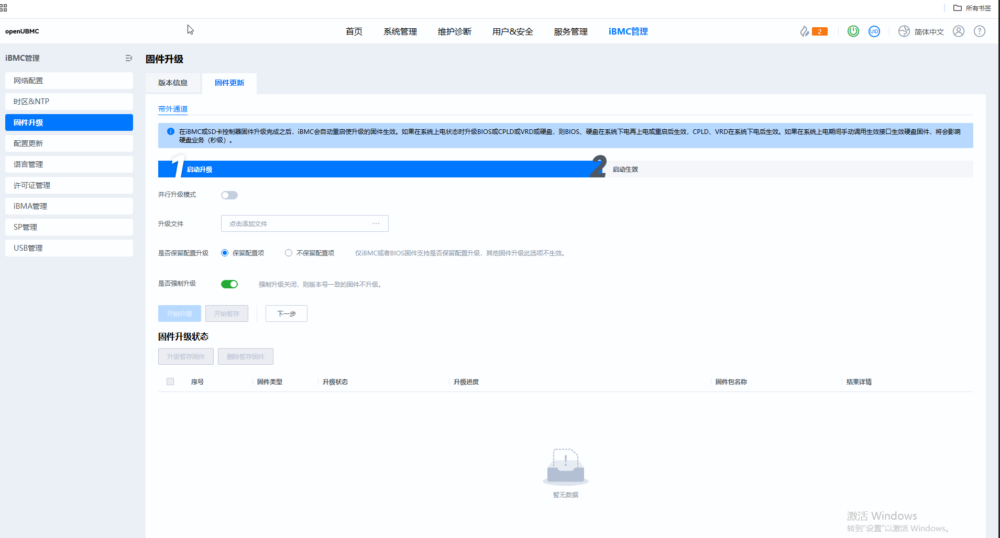
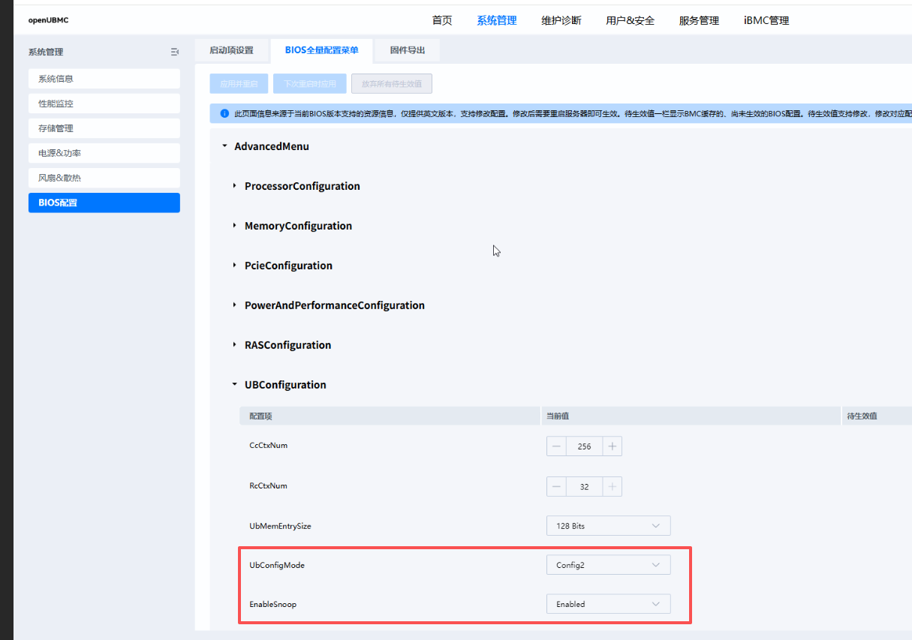
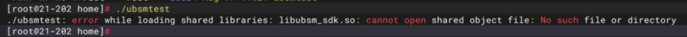

## 一、安装 OS (openEuler 24.03 LTS SP4 everything)

详情参考[安装openEuler_2003_SP4](./安装openEuler_2003_SP4.md)。

## 二、固件升级

如下图，依次进行固件升级，登录 ibmc 网页后，点击 iBMC管理->固件升级->固件更新。



然后点击添加文件->开始升级，看到图片中下方的固件升级状态显示升级成功即可。

>注意：
>
> 1. 有些固件升级完会自动上电，这时可以看一下远程控制台，确保已经完成上电后再点击下电，之后就可以继续升级后续固件了，升级固件一定要机器在下电状态。
>
> 2. 每个固件升级完成的中间间隔一段时间，不要衔接太紧，显示升级完成并不是真正升级完成。
>
> 3. 固件升级的顺序为 [1_BMC](images/包/B006/Kunpeng-Board/1_BMC/)->[2_CSR](images/包/CSR用这个里面的/)->[3_RE_CPLD](images/包/B006/Kunpeng-Board/3_RE_CPLD/)->[4_Base_CPLD](images/包/B006/Kunpeng-Board/4_Base_CPLD/)->[5_FE_CPLD](images/包/B006/Kunpeng-Board/5_FE_CPLD/)->[6_Back_CPLD](images/包/B006/Kunpeng-Board/6_Back_CPLD/)->[7_OCP](images/包/B006/Kunpeng-Board/7_OCP/)->[8_BIOS](images/包/bios升级用这个里面的/)->[9_VRD](images/包/B006/Kunpeng-Board/9_VRD/)。
>
> 4. 第七个固件会检查硬件是否符合要求，这个固件如果升级失败可以暂时不管，跳过升级后续固件。

## 三、安装 UBM\UBE\UBSE\UBSM

详情参考[通算软件部署端到端安装指导](images/包/通算软件部署端到端安装指导.docx)。

该文档执行完成后，查询各软件包是否正确运行，回显为active说明ok

```
systemctl status ubse
systemctl status ubm
systemctl status ubsm
```

>注意：
>
> 1. 主要关注红色部分就好，完成了一、二章节的操作的话文档从2.1.3章节开始操作即可。
>
> 2. 本地源配置、update源配置具体步骤见文档2.1.1章节

## 四、修改 BIOS 参数中的 UBConfig

如下图，修改 UbConfigMode 为 Config2；修改 EnableSnoop 为 Enabled。



然后点击上方的【应用并重启】，待重启完成后，跑一下 [ubsmtest](images/包/) 如果回显 "All tests passwd!"即为安装部署完成。

如果跑 ubsmtest 时出现如下图的报错，执行一下`cp /usr/local/ubs_mem/lib/libubsm_sdk.so /usr/lib64`

